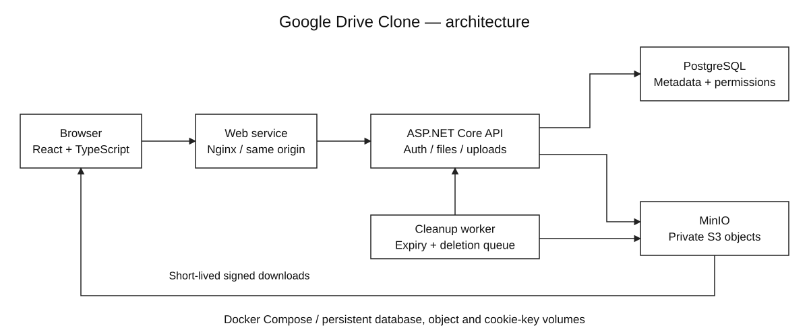
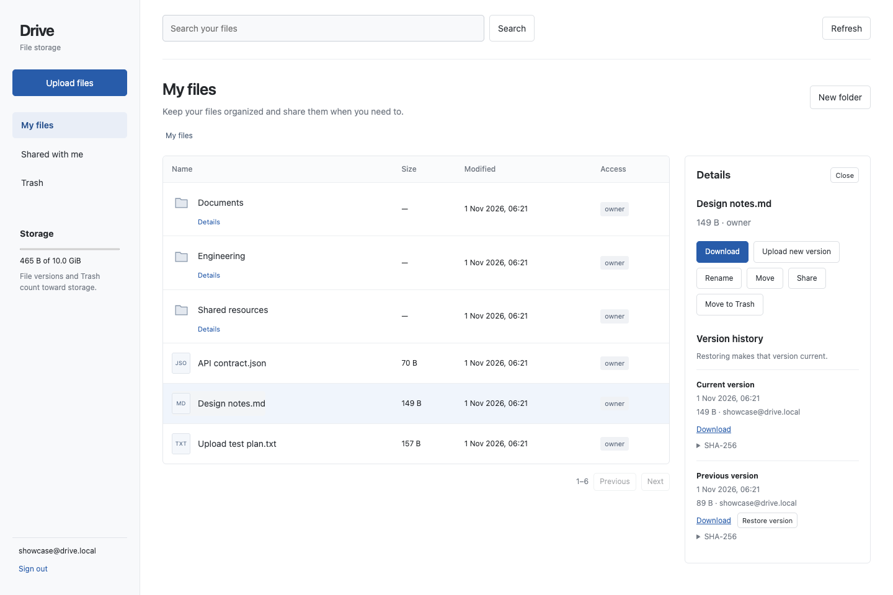
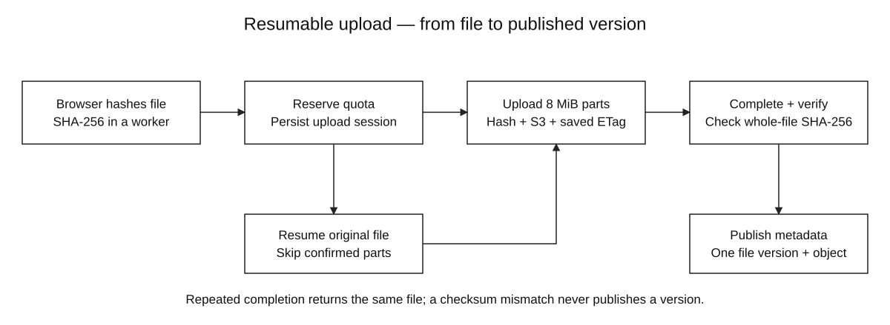

# Full-Stack Google Drive Clone

A self-hosted file storage application built with **React, TypeScript, C# / ASP.NET Core, PostgreSQL and S3-compatible object storage**. Upload large files in parts, resume interrupted transfers, share files with explicit permissions, and restore previous versions.

**Multipart uploads · SHA-256 integrity checks · transactional quota reservations · version history · expiring share links · Docker Compose**

## Architecture



PostgreSQL owns the directory tree, access rules, upload sessions, confirmed parts and file versions. MinIO stores the file bytes. The browser uploads through the API; downloads use short-lived S3 presigned URLs. Files become visible only after the assembled object's size and SHA-256 match the original file.

MinIO is built from a pinned upstream source commit in [its Dockerfile](infra/minio/Dockerfile). No cloud account, paid S3 service or external API key is required.

## Run with Docker

Requirements: Docker Engine with Compose v2, or Docker Desktop on macOS/Windows; Python 3 for generating local credentials. The first build compiles MinIO from source and needs several GB of free build space.

```sh
git clone https://github.com/pigglegiggle/google-drive-clone.git
cd google-drive-clone
python3 scripts/configure.py
docker compose up -d --build --wait
```

On Windows, use `py -3 scripts/configure.py` if `python3` is not available, then run the same Docker command with Docker Desktop using Linux containers.

Open **http://localhost:8090** and create an account. There is no default account or production demo password. `scripts/configure.py` creates private random service credentials in `.env` and refuses to overwrite an existing file.

```sh
docker compose ps
docker compose logs -f --tail=50
docker compose down
```

`down` stops containers and preserves data. Database, objects and authentication keys live in named volumes. Avoid `down -v` unless you intend to delete all application data. Edit `.env` for ports and the browser-accessible S3 endpoint; restart the services after changing it.

For a VPS with your own domain and HTTPS, see [deployment](docs/DEPLOYMENT.md). For native development on a Mac or Linux, see [how to run](docs/HOW_TO_RUN.md).

## Use the application



1. Create an account and organize files into folders.
2. Select **Upload files**. A Web Worker computes the original file checksum, then the browser sends up to three parts concurrently.
3. Pause a transfer or close the page. Open Drive again, choose **Resume upload**, and select the original file. Only missing confirmed parts are sent.
4. Select a file to download it, rename/move it, upload a new version, inspect checksums or restore an earlier version.
5. Share with another registered account as a viewer/editor, or create an expiring download link. Revoke access from the same panel.
6. Move an item to Trash, restore it, or permanently delete it and its versions.

The interface supports nested folders, global filename search within your account, paginated file lists, a shared-files view, storage usage and an upload queue. All user-facing text is English.

## Upload and recovery design



- **Bounded transfer:** 8 MiB parts, up to three browser workers per file, eight API part workers per process. Each request spools one part to a temporary file while hashing it; the API does not buffer an entire file in memory.
- **Resume state:** upload IDs and confirmed part numbers, ETags, sizes and checksums are stored in PostgreSQL. Re-selecting the file verifies its whole-file hash before resuming.
- **Idempotency:** repeated parts with the same claimed hash reuse confirmed state; conflicting hashes return 409. Repeated completion returns the previously published file ID.
- **Publication boundary:** S3 completion happens before a database transaction publishes a version. If S3 succeeds and the transaction fails, retry discovers the existing object, verifies it and retries publication.
- **Integrity:** the API checks each received part, then streams the completed object back from S3 for a whole-file SHA-256 check. A mismatch leaves no visible file version.
- **Quota:** an owner-row lock serializes space reservations and metadata changes. All stored versions, including files in Trash, count toward quota. Active uploads reserve their expected size.
- **Cleanup:** expired uploads and permanent deletions enqueue storage cleanup transactionally. A background worker retries deletion. MinIO is configured to expire stale multipart uploads after 48 hours with hourly cleanup, covering an initiation that never reached PostgreSQL.

Database row locks and per-part advisory locks coordinate multiple API processes. Cookie encryption keys must be shared across replicas. Eight part workers is a **per-process** limit; this repository does not include an autoscaling deployment.

## Permissions and limits

| Capability | Owner | Editor | Viewer | Public link |
|---|---|---|---|---|
| Download current file | Yes | Yes | Yes | Yes, before expiry |
| Download version history | Yes | Yes | Yes | No |
| Upload / restore a version | Yes | Yes | No | No |
| Rename, move, trash, share | Yes | No | No | No |

Sharing applies to individual files. Folder permissions and inherited grants are not implemented. Trashing a parent folder hides its descendants from authenticated and public access until restored.

- Maximum file size: **5 GiB**; account quota: **10 GiB**; at most **5 active uploads** per account. These are configured limits, not claims that 5 GiB transfers were benchmarked.
- Upload sessions expire after 24 hours. File versions use separate immutable object keys; restore selects an existing version without duplicating its bytes or changing its original creation date.
- Download URLs last five minutes. Revoking a share blocks new downloads, but an already issued presigned URL remains usable until its expiry.
- Passwords use the ASP.NET password hasher with PBKDF2; authentication uses HttpOnly, SameSite=Strict cookies and persisted Data Protection keys. All mutations require a custom request header; the API enables no cross-origin CORS policy.
- Registration is open for the showcase. There is no email verification, password reset, antivirus scanning, collaborative document editing, desktop sync client or multi-region replication.

See [architecture and invariants](docs/ARCHITECTURE.md) for transaction and failure details and [API reference](docs/API.md) for request contracts.

## Verification

```sh
# With the Compose stack running:
BASE_URL=http://localhost:8090 python3 tests/integration.py
npm ci --prefix frontend
cd frontend
npx playwright install chromium
UI_URL=http://localhost:8090 npm run test:e2e
cd ..
python3 tests/recovery.py --compose
```

PowerShell: set `$env:BASE_URL = 'http://localhost:8090'` and `$env:UI_URL = 'http://localhost:8090'` before the Python/npm commands.

The integration suite uses real HTTP, PostgreSQL and S3 storage. It exercises binary multipart uploads, confirmed-part reuse, wrong checksums, duplicate finalization, access revocation during upload, public-link revocation, version restore, hidden ancestors, empty files, name-conflict recovery and recursive deletion. Four browser tests exercise actual UI workflows, pause/resume, file moves and narrow screens. Restart tests stop the API between parts and verify that both the authentication cookie and upload survive.

[Validation evidence](docs/VALIDATION.md) records the environment actually executed. The [full Docker Compose verification](https://github.com/pigglegiggle/google-drive-clone/actions/runs/41252708727) passed with source-built upstream MinIO, 95 integration checks, quota/expiry checks, four browser workflows and API-container restart recovery.

## Repository map

```text
backend/             ASP.NET Core API, SQL schema, S3 client and cleanup worker
frontend/            React UI, incremental checksum worker and multipart uploader
infra/minio/         Pinned upstream MinIO source build
compose.yaml         PostgreSQL, MinIO, API and web services
compose.https.yaml   Optional Caddy deployment for your own domains
tests/               Real-storage integration and process/container restart checks
frontend/tests/      Browser interaction tests
scripts/             Local configuration, backup and diagram generation
docs/                Architecture, API, deployment, validation and diagrams
study/               Private study notes, ignored by Git
```

The diagrams are plain SVG with [editable draw.io sources](docs/DIAGRAMS.md). Application code uses the [MIT license](LICENSE); the separate MinIO service uses [AGPLv3](infra/minio/SOURCE.md).
